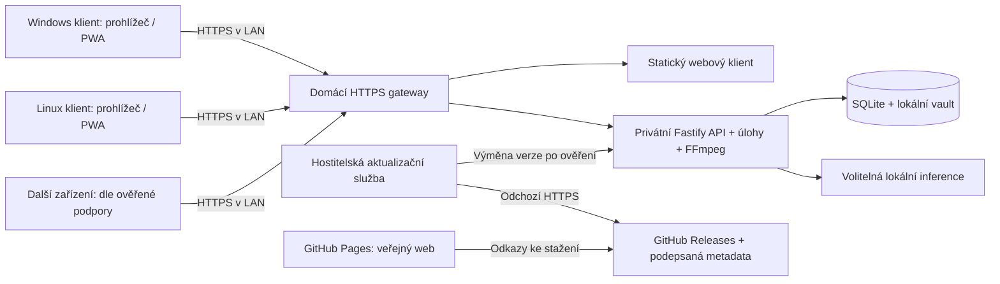

# Plán distribuce a nasazení StreamerAI

Datum návrhu: 2026-11-03. Implementace zahájena: 2026-11-04, aktualizace 2026-11-05.

Tento dokument popisuje cílový rozsah. Implementace nyní obsahuje produkční
runtime a distribuční prototyp, volitelné párování klientů, offline zálohu CLI,
šifrovanou obnovu domácnosti a opaque cloud checkpoint protokol, diagnostiku,
řízené PWA aktualizace a statický veřejný web. Podrobný stav a zbývající brány
jsou v [DEPLOY_IMPLEMENTATION.md](DEPLOY_IMPLEMENTATION.md). Nic z toho samo
neznamená nasazení do cloudu či publikování podepsaného stabilního vydání.
Plán navazuje na [schválenou architekturu](../instructions/DEPLOY.md);
případné nové produktové volby jsou zde doporučení, nikoli již schválené změny.

## 1. Doporučená podoba první distribuované verze

Jeden domácí server pro Windows nebo Linux, více tenkých klientů ve stejné síti.
Klientem je současná React aplikace v prohlížeči, případně nainstalovaná PWA.
Server a klient mohou běžet i na jednom počítači. Samostatný Electron/Tauri
klient není pro první vydání potřebný; případný budoucí klient použije stejné API.

Server spravuje SQLite, profily, přístup ke zdrojům, tajné údaje, vyhledávání,
AI a FFmpeg. Klienti používají společná data přímo z tohoto serveru.
Synchronizace mezi zařízeními jedné domácnosti proto nepotřebuje cloud.
Volitelná cloudová identita/synchronizace zůstává oddělená od lokálního přístupu.
Pro přenesení celé domácnosti na další server je nově požadována volitelná
end-to-end šifrovaná synchronizace včetně obnovitelných přístupů ke službám;
návrh a omezení jsou v části 5A.

Server musí být zapnutý během používání ostatních klientů. První podporovaný
rozsah zůstává nejvýše pět profilů a jeden souběžný stream. Více připojených
klientů neznamená automaticky více souběžných transkódování.

## 2. Co už v repozitáři existuje a co chybí

| Oblast | Zjištěný stav | Potřebná práce |
| --- | --- | --- |
| Server/klient | Fastify, React/Vite PWA, SQLite, FFmpeg | Distribuční balení a správa životního cyklu služby. |
| Docker | Dva obrazy, nginx, persistentní volume, health check | Vydávané hotové obrazy a řízená aktualizace. |
| LAN | Compose publikuje pouze `127.0.0.1:8080` | Řízené zapnutí LAN, firewall, HTTPS, párování. |
| Přístup | Bez account service je lokální API důvěryhodné; lokální vstup sám neověřuje správce domácnosti | Samostatná autentizace správce a schválení zařízení před zpřístupněním LAN. |
| Online párování | QR/kód přes existující Worker, Google/e-mail, lokální session | Lokální párování bez internetu a bez automatického přístupu pouhým online přihlášením. |
| Obnova a sync domácnosti | Stávající cloud synchronizuje část stavu, nikoli credentials/PINy; data v cloudu nejsou E2EE | Šifrovaný přenos profilů a credentials, správa klíčů, obnova a souběžný sync. |
| Offline záloha serveru | Existuje záloha SQLite před vybranou migrací; databáze, vault a master key se dnes zálohují odděleně | Uživatelský šifrovaný export do souboru, obnova a ověřený postup bez internetu; viz část 5B. |
| PWA aktualizace | VitePWA má `registerType: "autoUpdate"` | Ověřit aktivaci, odložit reload při přehrávání a řešit kompatibilitu se serverem. |
| CI | Linux job spouští `pnpm check` | Windows/Linux balíčky, instalační a upgrade testy, podepisování, release workflow. |
| Produkční runtime | Docker server spouští TypeScript přes `tsx`, základ používá Node 22 | Produkční build JS a sjednocení s deklarovaným cílem Node 24 po ověření závislostí. |

Podklady: [compose.yaml](../compose.yaml), [Dockerfile.server](../Dockerfile.server),
[Vite konfigurace](../apps/web/vite.config.ts), [CI](../.github/workflows/ci.yml),
[autentizační služba](../apps/server/src/services/account-auth.ts),
[účty](ACCOUNTS.md) a [aktuální Docker nasazení](DEPLOYMENT.md).

## 3. Balíčky pro Windows a Linux

Výchozí produktová cesta: nativně instalovaný server jako služba a webový klient.
Docker zůstane podporovanou cestou pro pokročilé uživatele a prvním pilotním
prostředím; Windows instalace bez Dockeru nesmí skrytě vyžadovat WSL.

| Cíl | Navržený artefakt | Běh a data |
| --- | --- | --- |
| Windows x64 | Podepsaný `StreamerAI-Server-<verze>-win-x64-setup.exe` | Služba pod omezeným účtem, launcher pro otevření UI a stav služby; data v `%ProgramData%\StreamerAI`. |
| Linux x64 | `streamerai-server-<verze>-linux-x64.tar.xz` a ověřující instalátor | Pro první vydání vybrané podporované Ubuntu/Debian se systemd; omezený účet, `/var/lib/streamerai`, runtime v `/opt/streamerai/releases/<verze>`. |
| Docker Linux/Windows host | Verze obrazů v GHCR + vydávaný Compose balíček | Existující volume; na Windows výslovně vyžaduje Docker Desktop s Linux kontejnery. |
| Klient Windows/Linux | Webový klient přibalený ke stejné verzi serveru | Prohlížeč/PWA, bez Node, pnpm, FFmpeg a provider klíčů na klientovi. |

První release zacílí na Windows 11 x64 a konkrétní otestované LTS verze
Ubuntu/Debian; přesná matice se uzavře po instalačním prototypu. ARM64, jiné
distribuce, Windows Server a TV platformy se neoznačí jako podporované bez testu.

Balíček obsahuje Node runtime, zkompilovaný server, web, nativní závislosti,
FFmpeg/FFprobe a gateway. `better-sqlite3` se sestaví nebo získá pro konkrétní
OS/architekturu/Node ABI; nelze kopírovat vývojové `node_modules` mezi OS.
Před vydáním připravit licence a notices pro skutečně distribuované sestavení
FFmpeg i ostatní komponenty. Ollama a model zatím zůstávají volitelné externí
komponenty s průvodcem a preflightem, bez tichého stahování či aktualizování.

Instalátor vytvoří službu, adresáře a oprávnění; po instalaci otevře lokální
průvodce. Program, aktualizační staging a uživatelská data musí být oddělené.
Odinstalace standardně zachová data a klíč; jejich odstranění je samostatná
výslovná volba. Změna instalační verze nemění identitu domácího serveru.

## 4. Jak zařízení najde server

První verze nabízí adresu a QR na obrazovce serveru: stabilní název
`streamer-<kratke-id>.local` a záložní aktuální LAN adresu. Doporučit DHCP
rezervaci v routeru. `localhost` na TV nebo druhém PC odkazuje na toto zařízení,
nikoli na domácí server.

Server může oznamovat službu přes mDNS/DNS-SD. To je pomoc s nalezením služby,
nikoli ověření její identity. Název a veřejné `serverId` neudělují přístup.
Konkrétní service type a knihovnu zvolit při prototypu; do oznámení nepatří
profily, e-maily, tokeny ani interní konfigurace. Základem protokolu je
[DNS-SD, RFC 6763](https://www.rfc-editor.org/rfc/rfc6763).

Běžný webový klient nemá obecné rozhraní pro vyhledávání libovolných mDNS
služeb. V první verzi proto zadá adresu nebo otevře QR a až pak používá API.
Automatický seznam „Servery v okolí“ je pozdější možnost pro nativní launcher.
Samotné rozlišení známého `.local` názvu není totéž jako vyhledání všech serverů.

Počítat s blokovaným multicastem, guest Wi-Fi, izolací klientů, VLAN, VPN,
více síťovými kartami, IPv6 a konfliktem názvů. Ruční adresa zůstane dostupná.
Oddělené VLAN mohou vyžadovat nastavení routeru; aplikace je sama nepropojí.
Server neprohledává router ani neinzeruje, že pozná každé zařízení připojené
k Wi-Fi. O novém klientovi se dozví až jeho požadavkem na aplikaci.

## 5. Jak server rozpozná a schválí nové zařízení

Rozlišovat serverovou instalaci, domácnost/účet, zařízení a divácký profil.
Zařízení je v prohlížečové verzi konkrétní instalace prohlížeče/PWA, nikoli
spolehlivě identifikovaný fyzický televizor či počítač.

1. První správce vznikne při instalaci: launcher na hostiteli předá jednorázový
   bootstrap secret do lokálního průvodce. Secret se neloguje a po použití
   zanikne. Samotný první příchozí požadavek z LAN nesmí získat vlastnictví.
   LAN listener se zpřístupní až po dokončení této inicializace.
2. Nový klient otevře adresu serveru. Bez platného přihlašovacího údaje uvidí
   pouze uvítání a tlačítko „Požádat o přístup“, nikoli profily či knihovnu.
3. Požadavek vytvoří krátkodobou párovací transakci svázanou s tímto klientem.
   Klient zobrazí vlastníkem rozpoznatelný název, osmiznakový kód a QR s adresou
   schvalovací stránky a identifikátorem žádosti. QR neobsahuje budoucí session.
4. Již přihlášený správce otevře „Zařízení“ nebo QR na svém zařízení, porovná
   kód a název a potvrdí přístup. Název dodává klient, takže sám není důkazem
   identity. Správce může žádost odmítnout.
5. Server vydá přihlašovací údaj pouze původnímu žádajícímu klientovi po ověření
   jeho vazby k transakci. Prohlížeč dostane `Secure; HttpOnly; SameSite`
   cookie; žádné trvalé bearer tokeny v URL nebo `localStorage`.
6. Další připojení se ověří podle náhodného přihlašovacího údaje a revokovatelného
   serverového záznamu. Teprve poté klient vybírá profil a případně zadává PIN.

Navržené limity: kód platí pět minut, je jednorázový, nejvýše pět chybných
pokusů na transakci; další omezení na klienta, adresu i celý server. Omezit
počet čekajících žádostí a interval pollingu. Schválení musí být atomické;
opakovaný poll nesmí vydat přihlašovací údaj jinému klientovi. Nezveřejňovat
seznam žádostí ani informace o domácnosti před autentizací.

Do databáze patří `serverId`, `deviceId`, příslušná domácnost, uživatelský název,
role `owner`/`viewer`, časy vytvoření a posledního použití, stav a hash tajného
údaje. Přihlašovací údaje rotovat; konkrétní expiraci uzavřít při návrhu session,
výchozí návrh je 30 dní neaktivity a opětovné ověření nejpozději po 90 dnech.
Správa zařízení umožní přejmenování a okamžité lokální odvolání všech jeho
session včetně streamů; nové požadavky i aktivní spojení musí respektovat revokaci.

IP adresa se může změnit, více klientů ji může sdílet a MAC adresu vzdáleného
klienta HTTP běžně neposkytuje. IP, MAC ani User-Agent proto nejsou identita.
Vymazání cookies, jiný prohlížeč nebo anonymní okno znamená nové párování.
Odcizená cookie může klienta napodobit; tento model neslibuje hardwarové ověření.

Online přihlášení již existujícího vlastníka může pomoci ověřit jeho identitu,
ale nesmí automaticky zpřístupnit jinou domácnost. Lokální párování musí fungovat
bez internetu. Lokální přístup a synchronizace mezi samostatnými servery jsou
dva různé mechanismy. Ztrátu posledního správce řeší lokální recovery nástroj
na hostiteli s oprávněním OS, který odvolá staré session a zachová data.

Zavedení musí upravit i současný `/auth/local` a všechny alternativní vstupy:
žádný z nich nesmí obejít párování. Existující trusted režim se při upgradu
nesmí tiše změnit v nechráněný LAN server; nejprve lokální převzetí správce.

## 5A. Kompletní šifrovaná synchronizace a obnova domácnosti

**Nový požadavek:** po přeinstalaci nebo přidání serveru obnovit profily a
připojené služby bez opětovného zadávání, pokud přenos daného přístupu příslušná
služba technicky umožňuje. Podporovat jednorázovou obnovu i průběžnou synchronizaci
mezi více nezávislými serverovými instalacemi.

Požadavek rozšiřuje původní pravidlo, které vylučuje credentials z cloudového
syncu: nově mohou být uloženy vzdáleně **pouze po zašifrování na domácím serveru**
klíčem, který provozovatel úložiště nezná. Jde o budoucí návrh. Před realizací
aktualizovat i pravidla v `instructions/DEPLOY.md` a `instructions/INTEGRATIONS.md`
a příslušné kontrakty; stávající implementace se tímto dokumentem nemění.

### Co obnovit

Synchronizovaná jednotka je domácnost/účet se svými profily a připojenými
službami. Zahrnout veškerý podporovaný stav profilů: nastavení, preference,
vzhled, knihovnu, historii, rozehrané pozice, uživatelské opravy a další
uživatelská data. Zahrnout nastavení služeb a obnovitelné přístupy včetně API
klíčů a přenositelných provider tokenů. Credentials jsou nyní sdílené účtem,
nikoli izolované profilem; zachovat jejich vlastníka a nesloučit je s jinou
domácností. Profilové PINy přenášet jako bezpečné ověřovací záznamy uvnitř
šifrovaného payloadu, nikoli jako čitelné PINy. Ověřit přenositelnost hashů,
solí a migrační postup; při nekompatibilitě profil ponechat zamčený a nabídnout
vlastníkovi obnovu PINu.

Každý synchronizovaný typ má explicitně registrované verzované schéma a test
obnovy. Chybějící nebo nepodporované položky zobrazit jmenovitě. Cache, videa
a stažitelné AI modely nejsou uživatelský profil. Nastavení lokálních cest a
zařízení může vyžadovat nové namapování; neoznačit je za funkční bez ověření.

Nepřenášet cloudové session, párovací údaje, lokální master key/vault jako celek,
CA privátní klíč, jednorázové kódy ani dočasné přímé odkazy na média. Nový
server dostane vlastní identitu a vault; klientská zařízení se znovu spárují.
Kompletní administrátorský snapshot původní instalace může zachovat její
identitu a zařízení, avšak současné spuštění jeho kopie jako druhého serveru
není podporováno. Pro nový server se jednotlivé obnovené credentials uloží
znovu zašifrované jeho vlastním lokálním klíčem.

### Šifrování a obnovovací klíč

- Pro každou domácnost vytvořit náhodný 256bitový datový klíč. Verzované položky
  zašifrovat ověřeným AEAD algoritmem pomocí udržované knihovny; každý zápis má
  bezpečný unikátní nonce. Identitu domácnosti, typu, položky, operace a verzi
  klíče svázat s payloadem jako authenticated data. Změna či záměna musí selhat.
- Datový klíč oddělit od místního klíče vaultu a na autorizovaných serverech
  ho uchovávat chráněný místním vaultem. Verzovat klíče a podporovat dokončení
  přerušené rotace; staré klíče zachovat po dobu převodu potřebných dat a záloh.
  Odvolání serveru ani rotace neodeberou již uložené nebo zkopírované údaje.
- Vygenerovat silný obnovovací klíč pro vlastníka a před dokončením aktivace
  ověřit, že si jej bezpečně uložil. Datový klíč uložit vzdáleně pouze v podobě
  zašifrované tímto nezávislým obnovovacím klíčem. Alternativní uživatelskou
  frázi zpracovat přes Argon2id s unikátní solí a verzovanými parametry; vyžaduje
  dostatečnou sílu proti offline hádání. Parametry a knihovnu otestovat na cílovém
  hardware. Viz [RFC 9106](https://www.rfc-editor.org/rfc/rfc9106.html) a
  [OWASP: Cryptographic Storage](https://cheatsheetseries.owasp.org/cheatsheets/Cryptographic_Storage_Cheat_Sheet.html).
- Umožnit bezpečnou výměnu obnovovacího klíče a nezávislou offline zálohu. Při
  ztrátě klíče je obnova možná ze zařízení, které vlastní potřebný datový klíč,
  nebo ze zálohy. Běžné připojení serveru přednostně používá schválení žádosti
  přes správu účtu a důvěryhodné zařízení podle postupu níže.
  Pokud nejsou dostupné, cloudová služba data nerozšifruje; obnovení e-mailového
  nebo Google účtu není obnovením šifrovacího klíče.
- Šifrování a dešifrování probíhá na autorizovaném serveru. Recovery secret
  nepatří do URL, logů, analytiky, bug reportu ani cloudového API. Při zadání z
  prohlížeče přes ověřené HTTPS krátce prochází tímto prohlížečem a serverem;
  je nutné důvěřovat aplikaci a serveru. Poskytovatel úložiště může vidět
  velikosti, časy a minimální technická metadata.

### Schválení nového serveru přes správu účtu

Pro běžné použití preferovat žádost o schválení; obnovovací klíč ponechat jako
záložní cestu pro ztrátu všech dostupných důvěryhodných zařízení. V budoucí
sekci **Zabezpečení a obnova** na `/account` zobrazit zařízení schopná potvrdit
obnovu, čekající žádosti, jejich stav a správu obnovovacího klíče. Současný
portál již umí ukázat žádosti o párování, ale **neumí** níže uvedený přenos
šifrovacích klíčů. Existující online device grant toto sám nezajišťuje.

1. Nový server přihlásí vlastníka k účtu, vytvoří krátkodobý pár klíčů a žádost
   o připojení ke konkrétní domácnosti. Na novém serveru se zobrazí název a
   ověřovací kód odvozený z celého kryptografického spojení včetně veřejných
   klíčů. Jeho privátní klíč zůstává na novém serveru.
2. `/account` ukáže žádost a může o ní upozornit e-mailem. E-mail ani odkaz
   neobsahují dešifrovací klíč a samotné kliknutí v e-mailu nepředává přístup.
   Uživatel otevře dostupný již schválený server nebo předem zaregistrované
   důvěryhodné zařízení, které pro danou domácnost skutečně drží potřebný klíč.
3. Na důvěryhodném zařízení vlastník po čerstvém ověření své identity porovná
   zobrazený ověřovací kód s novým serverem a žádost potvrdí. Zobrazení na
   samotném hostovaném `/account` bez dříve zaregistrovaného klíče nestačí: jen
   přihlášený prohlížeč ještě nemusí být zařízení schopné uvolnit klíč. Součástí
   implementace je případná registrace a bezpečné uložení klíče na takovém
   zařízení; pro první verzi může schvalovat existující domácí server.
4. Důvěryhodné zařízení předá datový klíč cíleně novému serveru pomocí ověřené
   výměny klíčů a šifrované obálky svázané s účtem, domácností, žádostí,
   jednorázovým veřejným klíčem a jejím schválením. Worker slouží jako relay a
   vidí jen ciphertext a nezbytná metadata; nesmí být schopen podstrčit klíč
   či vyvolat schválení bez účasti držitele klíče. Zvolit a podrobit review
   existující protokol s autentizací spojení a porovnáním kódu, nikoli vlastní
   kryptografický protokol.
5. Nový server ověří integritu, uloží klíč chráněný vlastním vaultem a obnoví
   šifrovaná data. Žádost je časově omezená, jednorázová a odvolatelná;
   zavést rate limiting, ochranu proti replayi a vyčerpání žádostí a záznam
   události bez tajných údajů. Při vypnutém schvalujícím serveru se čeká na jeho
   dostupnost nebo lze použít obnovovací klíč. Převzetí online účtu samotné
   nesmí z úložiště získat klíč bez důvěryhodného zařízení nebo zálohy.

Stejná sekce může nabídnout **Vytvořit nový obnovovací klíč**. Po schválení na
důvěryhodném zařízení se vygeneruje nový klíč a datový klíč se jím nově zaobalí;
nejde o zobrazení zapomenutého starého klíče. Vlastník musí novou zálohu uložit
a ověřit, pak lze zneplatnit starou cloudovou obálku. Odděleně uložené starší
offline zálohy mohou být dál dešifrovatelné starým klíčem; pro řešení kompromitace
je zapotřebí rotace datového klíče a obnova záloh, ne jen změna obálky.

Pokud vlastník přišel o všechna zařízení s datovým klíčem i o záložní obnovovací
klíč, samotný cloudový účet nestačí k obnově. Alternativou by byla výslovně
zapnutá úschova klíče u provozovatele, která umožní obnovu pouze přes účet,
ale změní model důvěry: provozovatel nebo útočník s přístupem k úschově může
získat schopnost data rozšifrovat. Takový režim zatím nezavádět jako E2EE;
případně jej samostatně navrhnout, pojmenovat a vysvětlit před aktivací.

### Transport, obnova a synchronizace

Současný `D1AccountSyncTransport` a cloudový protokol nejsou E2EE: Worker vidí
obsah nyní synchronizovaných profilů a credentials vylučuje. Zavést **nový
verzovaný transport pro neprůhledné šifrované payloady**, včetně všech dat
profilu; samotné zašifrování credentials by nestačilo. Autentizace k úložišti
a šifrování jsou oddělené. Původní plaintextové cloudové kopie se migrací samy
nesmažou: po ověření nové kopie nabídnout jejich výslovné odstranění a vysvětlit
skutečnou retenční dobu záloh konkrétního úložiště.

Výchozí návrh je samostatná verze StreamerAI Worker/D1 transportu s minimálními
indexy, prověřenou kvótou a správou verzovaných objektů. Existující Worker nelze
označit za E2EE, dokud tento protokol nepodporuje. Pozdější Google Drive adaptér
může použít stejný šifrovaný formát; zatím není implementovaný a má samostatné
OAuth překážky. `appDataFolder` může uživatel smazat a není nezávislou zálohou:
viz [Google Drive app data](https://developers.google.com/workspace/drive/api/guides/appdata).
Pro provoz bez cloudu nabídnout také šifrovaný export/import; export i obnovovací
klíč musí být bezpečně uloženy mimo zdrojový server.

Při obnově vlastník založí lokální správu nového serveru, přihlásí účet úložiště
a schválí žádost dle postupu výše, nebo načte export a zadá obnovovací klíč.
Záložní klíč lze zadat i při obnově z cloudu. Aplikace ověří dataset, integritu a
kompatibilitu, zobrazí náhled profilů/služeb i případné konflikty a po potvrzení
obnoví data do nové nebo výslovně zvolené domácnosti. Účty neslučovat podle
e-mailu. Přihlášení k úložišti, obnova šifrovacího klíče a schválení serveru
jsou samostatné kroky.

Pro více serverů použít neměnné verzované operace, ID operací, opakovatelný
import, autentizované checkpointy, odolný outbox a tombstones. Offline změny
profilů řešit deterministicky podle druhu dat. Souběžné změny credentials nesmí
potichu přepsat jinou hodnotu: uchovat obě zašifrované varianty a vyžádat výběr
vlastníka. Smazané přístupy nesmí vrátit starší offline operace. Bezpečné
prořezávání tombstones vyžaduje vlastní ověřený protokol obnovy. Při souběžném
vytvoření profilů dodržet limit pěti a přebývající data ponechat pro řešení.

Token může exspirovat, být vázán na zařízení nebo mít zakázaný přenos. Po importu
ověřit jednotlivé služby a případně nabídnout nové přihlášení. Jednorázové nebo
rotující refresh tokeny nesmí více serverů nezávisle obnovovat bez řešení
koordinace a offline provozu. Platný přenositelný přístup znovu nevyžadovat.
V nastavení ukázat místo uložení, poslední úspěch a stav položek; odděleně
nabídnout pozastavení, odebrání serveru, výměnu klíčů, export a smazání
vzdálených dat. Pozastavení nic nemaže; po smazání se data nesmí sama nahrát
zpět. Přenos profilu mezi různými účty nesmí bez svolení převést přístupy celé
domácnosti.

Před vydáním provést bezpečnostní review a otestovat obnovu mezi Windows/Linux,
doručení a schválení žádosti, nedostupného schvalovatele, rozdílný kód, záměnu
veřejných klíčů, schválení z neautorizovaného portálu, replay, expiraci a ztrátu
online účtu či zařízení, výměnu a zneplatnění obnovovacího klíče,
dva servery s offline změnami, konflikty a mazání, limit profilů, expiraci a
rotaci provider tokenů, přerušený upload/rotaci klíčů, nesprávný klíč, porušený
payload, export a ztrátu posledního klíče. Kontrolou úložiště a logů prokázat,
že neobsahují plaintext synchronizovaných profilů a credentials.

## 5B. Offline záloha a obnova celého serveru

Uživatel musí mít možnost vytvořit **jeden přenositelný šifrovaný soubor** se
zálohou serveru, uložit jej například na USB disk a ze souboru obnovit server
bez internetu, cloudového účtu, online schválení nebo původního počítače. Tato
funkce je součástí prvního veřejného vydání a není závislá na realizaci cloudového
syncu z části 5A. Vytvoření ani obnova nesmějí tajně vyvolat síťové spojení.

### Obsah zálohy a rozsah

Výchozí **záloha serveru** obsahuje konzistentní místní databázi se všemi
domácnostmi, profily, knihovnou, historií, pozicemi, PIN verifiery a nastavením;
vault s obnovitelnými přístupy ke službám a vše potřebné k jeho rozšifrování;
konfiguraci, mapování a potřebný stav úloh a synchronizace. Citlivé údaje,
včetně lokálního master key, se smějí nacházet jen uvnitř plně šifrovaného
zálohového souboru. Vlastnictví účtů a vazby secretů zůstanou zachované.

Uživatel před vytvořením uvidí přehled a velikost zahrnutých i vynechaných
položek. Volitelně lze zabalit vybrané lokální mediální soubory, pokud jsou
dostupné a uživatel určí cesty; implicitně se zálohuje jejich nastavení a
metadata, nikoli obsah disků. Volitelně nabídnout přibalení již staženého modelu
AI a kompatibilních instalačních artefaktů pro cílový OS, jsou-li k dispozici a
jejich distribuce to umožňuje. Žádný obsah se kvůli záloze nestahuje. Cache a
snadno obnovitelné dočasné soubory jsou standardně vynechané a vypsané v náhledu.

Přenesení samotného datového souboru nepředpokládá, že je v něm spustitelný
program pro každý OS. Před cestou bez internetu uživatel potřebuje mít na cíli
kompatibilní instalaci StreamerAI, případně příslušný offline instalátor a jeho
ověření; aplikace na tuto podmínku předem upozorní a nabídne připravené lokální
balíky, jsou-li k dispozici. K obnovení zálohy se nesmí vyžadovat stažení modelu,
Ollama, cloudové služby ani připojení externích poskytovatelů.

### Vytvoření souboru

1. V Nastavení serveru nabídnout **Zálohovat server**, volbu úložiště a obsahu,
   odhad velikosti a možnost uložit soubor přímo na zvolené lokální médium nebo
   jej stáhnout z důvěryhodného klienta. U vzdáleného stažení použít ověřené
   HTTPS, oprávnění správce a upozornit, že výsledný soubor skončí na klientovi.
2. Vlastník zvolí silnou zálohovou frázi nebo samostatně uložený obnovovací klíč;
   nemusí mít zapnutý cloud ani klíč z části 5A. Vygenerovat náhodný klíč pro
   šifrování zálohy, chránit jej klíčem zvoleným vlastníkem a uložit pouze jeho
   šifrovanou obálku. Frázi odvodit přes Argon2id s unikátní solí a verzovanými
   parametry; použít ověřenou knihovnu a autentizované šifrování s unikátními
   nonce. Klíč ani frázi neukládat v čitelné podobě do souboru, logů nebo URL.
   Při ztrátě fráze/klíče nelze zálohu obnovit; nabídnout bezpečné uložení zvlášť.
3. Koordinovat zápisy do DB i vaultu, aby odkazy a secrets představovaly tentýž
   okamžik. SQLite v režimu WAL zálohovat podporovaným konzistentním postupem;
   nekopírovat živý `.db` bez koordinace WAL. Zohlednit běžící úlohy, transakce
   a změny přístupů. Není-li konzistentní snímek možný, zálohu nedokončit.
4. Soubor opatřit verzovaným formátem, informací o verzi aplikace/schematu a
   autentizovaným manifestem s obsahem, délkami a kontrolami integrity. Citlivé
   názvy a metadata patří dovnitř šifrované části. Omezit přístup k pracovním
   souborům; kde je nutné dočasné nezašifrované staging úložiště, použít
   chráněný adresář/šifrovaný disk, po ukončení i restartu odstranit zbytky a
   neslibovat spolehlivé fyzické smazání na SSD. Možnost vytvářet konzistentní
   snapshot bez nechráněných plaintextových kopií ověřit před implementací.
5. Předat soubor atomicky až po dokončení zápisu a ověření čitelnosti, integrity
   a potřebných položek. Při chybě, nedostatku místa či přerušení ponechat
   předchozí zálohu a neúplný výstup neoznačit za platný. Nahlásit výsledek,
   datum a verzi; nabídnout následnou offline kontrolu a pravidelnou zkoušku
   obnovy. Volitelně plánované zálohy a lokální retenci, s upozorněním na chyby.

### Obnova ze souboru

Průvodce **Obnovit server ze zálohy** musí být dostupný při prvním spuštění i z
lokální správy na Windows a Linuxu. Import ze souboru a zadání zálohové fráze
fungují lokálně. Na čistém cíli se vlastník ověří lokálním administračním
oprávněním OS a schopností zálohu odemknout; online účet není podmínkou. Obnova
nezískává privilegia z pouhého neověřeného požadavku vzdáleného prohlížeče.

Po ověření celého souboru zobrazit datum, verzi, domácnosti, počet profilů,
rozsah služeb, zahrnuté soubory a případné nekompatibility. Před jakoukoli
změnou nabídnout dvě výslovné volby:

- **Nahradit původní server**: obnovit jako pokračování původní instalace,
  včetně serverové identity, pokud je obsažena a kompatibilní. Starý server musí
  být vyřazen z provozu; nepovolit bez varování současné používání klonu. Podle
  stavu relací a lokální CA může být nutné znovu navázat důvěru klientů.
- **Vytvořit nový server z dat**: obnovit domácnosti, profily a přístupy s novou
  serverovou identitou, novým lokálním vault klíčem a novým párováním klientů.
  Neobnovovat identity zařízení, cookies, dočasné relace ani privátní CA původní
  instalace. Případná pozdější synchronizace se starým serverem vyžaduje
  opětovné schválení a ošetření konfliktů podle části 5A.

Záloha může být starší než lokální či cloudový stav. Na obsazeném serveru před
přepsáním ukázat zasažená data, vyžádat výslovné potvrzení a vytvořit vlastní
ověřenou rollback zálohu. Dočasně pozastavit vzdálenou synchronizaci a uchovat
importovaný stav/outbox pro kontrolu; po návratu online provést explicitní
odsouhlasení připojení ke správnému účtu a reconciliation. Starý snapshot nesmí
tiše přepsat novější cloudová data, obnovit smazané údaje ani sloučit účty.

Obnovovat do oddělené pracovní oblasti, ověřit strukturu a integritu, povolené
cesty a velikosti archivu, kompatibilitu verze i migraci na kopii. Pak atomicky
přepnout na obnovovaná data; při chybě zachovat předchozí funkční instalaci a
umožnit opakování. Odmítnout novější nepodporované schema s návodem, jak použít
kompatibilní verzi. Neočekávat stejné cesty ani architekturu mezi Windows a
Linuxem; nabídnout přemapování a zřetelně vypsat nedostupné místní soubory.

Po obnově nabídnout **lokální offline přístup správce a profilů** na základě
odemknuté zálohy a lokálního oprávnění, se zachováním izolace domácností a PINů.
Obnovení online identity/cloudové session neprohlašovat za úspěšné bez síťového
ověření; po návratu internetu vyžádat případnou opětovnou autorizaci. Provider
credentials lokálně obnovit bez dotazování, jejich připojení prověřit až při
dostupnosti dané služby. Expirace či vazba tokenu na původní zařízení může
vyžadovat opětovné přihlášení a musí být v přehledu viditelná.

### Akceptace offline obnovy

- Odpojit internet, vytvořit zálohu včetně přístupů, přenést ji na jiný počítač
  a obnovit pouze se souborem, frází/klíčem a předem dostupným kompatibilním
  instalátorem. Žádné přihlášení, schválení ani ověření přes cloud.
- Ověřit Windows → Windows, Linux → Linux a přenos oběma směry mezi Windows a
  Linuxem; profily, PINy, knihovna, historie, nastavení, více domácností a
  přenositelné credentials odpovídají původnímu stavu. Nepřenositelný token
  a chybějící místní cestu aplikace správně oznámí.
- Ověřit oba režimy identity, vypnutý původní server, nové párování u nové
  instance, provoz s více domácnostmi bez úniku dat a pozdější bezpečné navázání
  cloud syncu bez ztráty novějších změn či návratu smazaných dat.
- Špatná fráze, změněný či neúplný soubor, nebezpečná cesta, chybějící místo,
  výpadek při exportu nebo přepnutí a nekompatibilní schema nesmí přepsat funkční
  data. Obnova ze záměrně staršího snapshotu musí vyžádat výslovné rozhodnutí.
- V dostupných pracovních souborech a výstupu zkontrolovat, že se secrets
  neobjevují v plaintextu mimo výslovně chráněný staging; ověřit cleanup po
  přerušení, hlášení vynechaných souborů a oboustrannou kontrolu integrity.

## 6. Síť, HTTPS a první připojení

Ven do LAN směřuje pouze gateway. API, SQLite, vault, Ollama a řídicí rozhraní
updateru zůstávají privátní. Firewall otevře zvolený HTTPS port jen pro určené
lokální sítě; na Windows se neotevře automaticky ve veřejném síťovém profilu.
Žádné UPnP ani automatický port forwarding. Vzdálený přístup přes privátní VPN
je samostatná pozdější funkce.

Web, API, události a média sdílejí jeden origin. Gateway má explicitní seznam
Host názvů; API kontroluje Origin a autorizaci a důvěřuje proxy hlavičkám jen
od skutečné gateway. Nestačí kontrolovat loopback adresu backendového spojení:
za proxy může takto vypadat i vzdálený klient. Nastavení pro více klientů musí
řešit stabilní kanonickou adresu a explicitně povolené alternativy.

PWA a service worker vyžadují bezpečný kontext; výjimka pro `localhost`
neznamená výjimku pro libovolnou LAN IP nebo `.local` název. Viz
[MDN: Secure contexts](https://developer.mozilla.org/en-US/docs/Web/Security/Defenses/Secure_Contexts).

Pro první Windows/Linux vydání navrhuji gateway Caddy s CA vytvořenou pro danou
domácnost. Vlastník musí na každém podporovaném klientovi ověřit otisk CA
zobrazený přímo na serveru a vědomě nainstalovat veřejný kořenový certifikát
do příslušného úložiště důvěry v OS/prohlížeči. Soukromý CA klíč se nedistribuuje.
Instalace CA na serveru sama nezajistí důvěru ostatních zařízení; viz
[Caddy: Automatic HTTPS](https://caddyserver.com/docs/automatic-https).

Tento bootstrap musí mít konkrétní ověřený návod pro Windows i Linux včetně
prohlížečů s vlastním úložištěm. Nelze doporučit trvalé ignorování chyb certifikátu
ani posílat session přes HTTP. HTTP lze ponechat pro přesměrování na HTTPS,
nikoli pro chráněný provoz.

U některých TV nelze vlastní CA rozumně nainstalovat. Takové TV nejsou součástí
zaručené první podpory. Před jejich podporou ověřit veřejně důvěryhodný certifikát
pro vlastní doménu s LAN DNS a DNS-01 obnovou bez otevření domácího serveru
internetu, včetně bezpečné správy DNS oprávnění. Centrální doména pro všechny
domácnosti by vyžadovala další návrh; nesmí se distribuovat společný privátní
certifikát nebo globální DNS token. Vyřešení důvěry HTTPS je release gate,
kterou samotné QR ani mDNS neodstraňují.

## 7. Automatické aktualizace

Aktualizují se dvě vrstvy: serverový balík a webový klient, který server dodává.
Runtime, web a nativní závislosti tvoří jednu otestovanou verzi. AI modely,
Ollama, osobní data a připojené zdroje mají vlastní životní cyklus.

Výchozí chování: automaticky kontrolovat a stáhnout stable aktualizaci, instalovat
v nastaveném servisním okně při nečinnosti. Nabídnout „instalovat teď“, odklad,
režim ručního schválení a samostatný beta kanál. Aktivní přehrávání a rozpracované
zápisy se nepřeruší; kritická aktualizace může vyžádat zásah správce, nikoli tiše
ukončit stream. Kontrola například po startu a každých 24 hodin s jitterem.
Bez internetu pokračuje nainstalovaná verze normálně.

Postup jedné aktualizace:

1. Ověřit podepsaná metadata kanálu, cílovou platformu, kompatibilitu, expiraci
   a ochranu proti nechtěnému downgrade. Důvěryhodný kořen je součástí instalace.
2. Stáhnout balík do stagingu a ověřit podpis, délku a hash před jeho spuštěním.
   Samotný SHA-256 soubor vedle instalačky ani HTTPS podpis nenahrazují.
3. Zkontrolovat místo, zámek aktualizace, dostupnost předchozí verze a stav úloh.
   Updater přežije restart aplikace i hostitele a rozpozná nedokončenou instalaci.
4. V servisním okně zastavit nové mutace, dokončit/pozastavit úlohy a pořídit
   konzistentní SQLite backup a odpovídající snapshot vaultu a konfigurace.
   Migraci nejprve ověřit na kopii. Zálohy obsahují citlivá data a mají omezená
   oprávnění; master key se zálohuje bezpečně a odděleně.
5. Zastavit službu a přepnout na připravený adresář verze. Supervisor/updater
   běží mimo měněný proces; aplikace nepřepisuje vlastní spuštěné soubory.
6. Spustit novou verzi, provést migrace a ověřit readiness, čtení/zápis DB,
   odemčení vaultu a dodání odpovídajícího klienta. Výpadek volitelného externího
   providera sám o sobě není důvodem k rollbacku.
7. Při selhání před otevřením provozu obnovit předchozí runtime a, vyžaduje-li
   to schema, celý konzistentní snapshot. Starý binární soubor nad novým
   nekompatibilním schematem není rollback. Zachovat stručnou lokální diagnostiku.

Po úspěšném otevření provozu preferovat opravu novější verzí. Pozdější obnova
snapshotu může zahodit nové změny a vyžaduje výslovný postup správce; nesmí
proběhnout automaticky. Pro schema používat podle možností postupné zpětně
kompatibilní migrace. Držet alespoň jednu ověřenou předchozí verzi a backup.

Implementační doporučení: prověřit udržovanou klientskou knihovnu pro
[The Update Framework](https://theupdateframework.github.io/specification/latest/)
namísto vlastní kryptografické implementace. Metadata musí mít verzování,
expiraci, bezpečnou rotaci klíčů a oddělený důvěryhodný root. Podepsané kanály
a metadata hostovat jako malé statické soubory; binární balíky v Releases.
Toto je návrh protokolu, nikoli tvrzení, že GitHub tyto kontroly provádí za klienta.

Na Windows má instalátor i aktualizace používat Authenticode; na Linuxu
ověřené podepsané distribuční balíky. Stahovací služba nepotřebuje plná práva
správce. Privilegovaný helper může pouze aktivovat ověřenou verzi v pevných
adresářích a spravovat určenou službu, ne spouštět libovolné příkazy od API.
Linuxový archiv je spravován vlastním instalátorem; případné budoucí deb/rpm
balíčky musí používat svůj balíčkovací systém a nesmí soupeřit s tímto updaterem.

Docker varianta používá vydané image připnuté na verzi/digest a hostitelský
update nástroj, který ověří vydání a přepne oba obrazy jako jeden celek se
stejnou zálohou a health kontrolou. Kontejner aplikace nedostane Docker socket.
Naslepo sledovaný `latest` ani obecný restart kontejnerů nenahradí tento postup.

Klient musí hlásit `clientBuild`, server `serverVersion` a podporovaný API
protokol; konkrétní veřejné rozhraní se doplní při implementaci. Podporovat
alespoň definované přechodné okno pro předchozí klientský build. Service worker
může stáhnout nové assety automaticky, ale aktivaci a reload je nutné řídit podle
přehrávání a neuloženého stavu. Viz [Vite PWA: Automatic reload](https://vite-pwa-org.netlify.app/guide/auto-update).
Necachovat privátní API, párování ani media granty; po odhlášení nezpřístupnit
data předchozího účtu z cache. Ověřit i otevřené karty a klienty vracející se po
delší době offline. PWA aktualizace sama nikdy neaktualizuje server.

## 8. Reportování chyb

První verze: „Nahlásit problém“ v Nastavení a na chybové obrazovce. Formulář
obsahuje popis, kroky, očekávaný a skutečný výsledek, čas a chybový identifikátor.
Aplikace připraví náhled diagnostiky: verzi serveru a klienta, OS/architekturu,
způsob instalace, anonymizované capability přehrávače, error code/request ID
a omezený sanitizovaný výřez logu. Screenshot je volitelný a samostatně potvrzený.

Diagnostika používá allowlist polí. Neodesílat cookies, session, párovací kódy,
klíče, provider tokeny, direct media URL, databázi, vault, historii sledování,
obsah konverzací, e-maily ani plné lokální cesty či síťové adresy. Sanitizace
probíhá před uložením exportu; uživatel vidí přesně to, co následně sdílí.

MVP nabídne:

- Otevření předvyplněného GitHub Issue s krátkým bezpečným souhrnem. Uživatel
  zkontroluje text a sám odešle; GitHub účet a přístup k repozitáři jsou nutné.
- Stažení sanitizovaného diagnostického balíčku a kopírování souhrnu i bez
  GitHub účtu nebo internetu. Export sám nevytvoří ticket a aplikace to musí
  výslovně říct; běžné logy se automaticky nikam neuploadují.
- Issue Forms pro bug/feature, štítky `bug`, `triage`, `windows`, `linux`,
  `playback`, `update`, odpovědnou triáž a uzavření s odkazem na opravené vydání.

GitHub podporuje issue templates a předvyplnění přes URL; viz
[Creating an issue](https://docs.github.com/en/issues/tracking-your-work-with-issues/using-issues/creating-an-issue).
Veřejný issue není vhodný pro citlivé přílohy. Web uvede oddělený neveřejný
kontakt pro bezpečnostní hlášení, jehož adresu vlastník připraví před publikací.

Pozdější pohodlné odeslání bez GitHub účtu může obsluhovat samostatný Worker
endpoint s ochranou proti spamu, limity, idempotencí a ticket ID. Vyžaduje
samostatné řešení příloh, uchování a mazání dat. GitHub App credential patří
jen do služby, nikdy do klienta nebo domácího distribučního balíku. Tento
cloudový příjem ani automatická crash telemetrie nejsou podmínkou lokálního MVP.

## 9. Veřejný web: GitHub Pages ano

Pro prezentační web a dokumentaci doporučuji GitHub Pages:
`https://<owner>.github.io/<repo>/`, případně vlastní doménu. Obsah: co aplikace
dělá, Windows/Linux download, podporované systémy, první instalace, HTTPS a
párování, aktualizace/rollback, FAQ, changelog, známé problémy, bug report,
ochrana soukromí a licence/attribution. Web jasně vysvětlí nutnost běžícího
domácího serveru a rozdíl mezi klientem a serverovým instalátorem.

[GitHub Pages je statický hosting](https://docs.github.com/en/pages/getting-started-with-github-pages/what-is-github-pages).
Z toho plyne rozdělení: Pages pro veřejné informace; domácí server pro vlastní
aplikaci a přehrávání; Releases pro balíky; případný Worker pro příjem hlášení.
Web na Pages nebude zkoušet skenovat LAN, přihlašovat uživatele k domácímu API
nebo přehrávat domácí obsah. Připojení k aplikaci vede přímo na domácí adresu.

[GitHub Releases](https://docs.github.com/en/repositories/releasing-projects-on-github/about-releases)
slouží pro instalační soubory a poznámky k vydání. Pokud zdrojový repozitář
zůstane soukromý, založit oddělený veřejný distribuční/support repozitář
s webem, Releases a Issues. Nedávat sdílený GitHub PAT do aplikace.
Pages na GitHub Free vyžaduje veřejný zdrojový repozitář; přístup k privátním
Releases by jinak komplikoval anonymní stahování a aktualizace.

Publikovat explicitně sestavený web z vlastní složky, nikoli celý současný
`docs/` s interními poznámkami. Ohlídat base path projektu, relativní odkazy
a 404. Instalačky a média nehostovat v Pages. Před komerční změnou ověřit
[limity a povolené použití Pages](https://docs.github.com/en/pages/getting-started-with-github-pages/github-pages-limits).

## 10. Release pipeline a provoz

1. Pull request: dosavadní `pnpm check`, platformní testy a cílené testy
   autentizace, aktualizací a migrací. Zmrazit lockfile a runtime verze.
2. Release kandidát: z jednoho commitu sestavit Windows/Linux balíky, web
   a obrazy; vytvořit licence, soupis závislostí a hashe. Přidat upgrade cestu,
   kompatibilitu a případné známé problémy do release notes.
3. Na čistých Windows/Linux VM ověřit instalaci, start po rebootu, klienta
   z druhého stroje, update z předchozí vydané verze, rollback a odinstalaci.
   Pro přehrávání navíc použít skutečný podporovaný hardware.
4. Podepsat balíky a metadata s oddělenými rolemi klíčů, nahrát draft Release.
   Podepisovací oprávnění nemají nedůvěryhodné PR joby. Používat minimální
   workflow oprávnění a připnuté Actions; offline root držet mimo běžné CI.
5. Ověřit stažení a upgrade skutečně nahraných artefaktů v beta kanálu.
   Stable metadata zveřejnit až po akceptaci; metadata odkazují pouze na hotové
   neměnné artefakty, ideálně totožné s ověřenou betou. Web aktualizovat nakonec.
6. Při problému zastavit nabídku vadné verze a vydat nová podepsaná metadata
   nebo opravu. Kontrolovat expiraci metadat a obnovu certifikátů; jejich výpadek
   nesmí zničit místní data nebo vypnout jinak funkční aplikaci.

## 11. Pořadí implementace a podmínky dokončení

| Fáze | Výstup | Podmínka pro pokračování |
| --- | --- | --- |
| P0: prototyp distribuce | Produkční runtime, Windows/Linux instalační prototyp, volba update knihovny, ověřené HTTPS na druhém PC | Čisté stroje bez vývojových nástrojů spustí aplikaci; potvrzená platformní matice a způsob důvěry CA. |
| P1: přístup v LAN | Lokální owner bootstrap, zařízení, párování, revokace, gateway a firewall | Cizí klient nevidí data a neobejde ochranu přes lokální vstup; párování funguje bez cloudu. |
| P2: bezpečný upgrade | Podepsané artefakty, updater, snapshoty, migrace, rollback, koordinace PWA | Aktualizace z předchozí verze i poruchový scénář zachovají data a nepřeruší aktivní film. |
| P2b: offline záloha | Šifrovaný přenositelný soubor, průvodce obnovou a offline instalace | Obnova mezi Windows/Linux bez sítě a cloudu, s daty a platnými přístupy podle části 5B. |
| P3: podpora a web | Diagnostický export, Issue Forms, veřejné instalační návody a download stránka | Report neobsahuje tajné údaje; návody zvládne nový uživatel na obou OS; download vede na podepsané balíky. |
| P3b: šifrovaný sync a obnova | E2EE transport, recovery klíče, export/import, profily a přenositelné přístupy služeb | Čistý server obnoví data a platné přístupy; dva servery se synchronizují podle části 5A. |
| P4: beta a stable | Ověřené release artefakty a následně stable kanál | Projdou níže uvedené scénáře a existující release gates přehrávání. |

P3 lze připravovat současně s P1/P2, ale veřejné tvrzení o podpoře a aktualizacích
musí odpovídat výsledkům P4. TV acceptance je samostatné rozšíření podle možností
certifikátů a přehrávače. Kalendářní odhad má smysl až po P0, která odhalí cenu
nativního balení, podpisů a klientského nastavení HTTPS.

Povinné akceptační scénáře pro první veřejné vydání:

- Čistá Windows i Linux instalace, reboot a obnova dat; server nepotřebuje
  vývojový pnpm a klient nepotřebuje instalovaný serverový runtime.
- Dva klienti používají stejnou domácnost; změna DHCP adresy nezmění identitu
  zařízení. Odmítnuté, expirované a odvolané zařízení nezíská přístup k API ani médiím.
- Správce schválí správnou žádost, útočník nepřevezme polling ani bootstrap;
  spojené browser origin/proxy/Host kontroly nemají náhradní nechráněnou cestu.
- Ruční připojení při nefunkčním mDNS, správná hláška při izolované guest síti,
  důvěryhodné HTTPS na podporovaných klientech, obnovení certifikátu.
- Odpojený internet umožní lokální přístup, párování a práci s lokálními daty;
  vzdálené zdroje jsou přirozeně nedostupné a chyba se jasně zobrazí.
- Update během filmu čeká; chybný podpis, replay starých metadat, nedostatek
  místa, výpadek napájení a selhání migrace nezanechají instalaci neobnovitelnou.
- Obnova DB/vaultu/klíče zachová profily, zařízení a přístup ke zdrojům; běžný
  update zachová stávající online účty a nevyžádá nové párování bez důvodu.
- Offline export do souboru a obnova na jiném počítači fungují bez cloudového
  účtu a původního serveru; podmínky identity a instalačního balíčku jsou uvedeny
  v části 5B.
- E2EE obnova na novém serveru zachová podporované profily a platné přenositelné
  přístupy bez jejich zadání; nový server má vlastní identitu a zařízení se
  znovu párují. Výjimky jednotlivých služeb jsou zřetelné.
- Starý otevřený PWA klient dostane srozumitelnou aktualizaci, privátní cache
  se nepřenese mezi účty a odhlášení/revokace ukončí přístup.
- Diagnostika je kontrolovatelná před sdílením, neobsahuje tajné údaje ani
  historii a export funguje i offline. Nový uživatel najde správný instalátor.
- Projdou relevantní existující akceptační brány z [VALIDATION.md](VALIDATION.md),
  zejména přehrávání, seek, titulky a nezveřejnění provider credentials.

## 12. Navazující změny v repozitáři při implementaci

Předpokládané oblasti, které v tomto kroku zůstávají beze změny:

- `apps/server/src/services/account-auth.ts`, session/repository/migrace:
  lokální owner a access policy, zařízení, revokace, kompatibilita účtů.
- `packages/contracts` a `apps/web`: párovací kontrakty, obrazovka schválení,
  správa zařízení, stav verze, odložený update a diagnostický náhled.
- Sync transport a Worker: nový verzovaný E2EE protokol, vlastnictví datasetu,
  obnova, provider credentials, konflikty a migrace stávajících účtů.
- Server, databáze a web: offline konzistentní snapshot, šifrovaný export,
  průvodce obnovou, platformní mapování a bezpečná obnova na čistém hostiteli.
- `deploy/` a budoucí `packaging/`: HTTPS gateway, platformní instalace,
  supervisor/updater, firewall a obnova.
- `Dockerfile.server`, `Dockerfile.web`, `compose.yaml`: produkční runtime,
  vydávané obrazy a společná verze; původní lokální vývoj musí zůstat použitelný.
- Budoucí release/Pages workflow, Issue Forms a veřejný web v samostatném
  adresáři nebo distribučním repozitáři.

Před implementací uzavřít volbu instalačního/podepisovacího nástroje, knihovny
pro aktualizace, přesnou OS matici, adresu veřejného distribučního repozitáře,
neveřejný bezpečnostní kontakt a otestovaný certifikační bootstrap. Pro tento
plán nejsou potřebné účty, klíče ani publikování nové infrastruktury.
